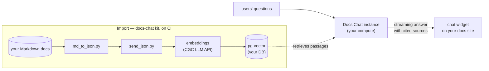

# Docs Chat

Docs Chat is a self-hosted AI assistant for your documentation, deployed in your own CGC namespace. You import your documents (Markdown) into its search index — from then on, it answers questions about **your** product, citing the exact passages it used, streaming the answer live.

It runs as your own instance: your database, your index, your LLM key. Nothing is shared between tenants — one instance serves one documentation site.

## What you get

- **Chat API** (`POST /api/v1/chat`) — streaming answers (SSE) with numbered citations and source cards, scope control ("this page" vs. "all documentation"), feedback endpoint, Prometheus metrics.
- **Import API** (`POST /api/v1/index/import`) — turns your Markdown corpus into an embedded, searchable index (pg-vector).
- **Health & status** (`GET /api/v1/health`, `GET /api/v1/status`) — readiness and index statistics.

Every answer is grounded in imported documents. If the answer is not in your corpus, the assistant says so instead of inventing one.

## How it works

1. **Import** — you point the importer at your documentation; it cleans the Markdown, chunks it and sends it to the instance. Embeddings are computed through the CGC LLM API. Import runs on your schedule (CI) or on demand — no manual steps in daily operation.
2. **Ask** — users ask through the widget on your docs site or directly over the API. The instance retrieves the most relevant passages, and the model answers with citations pointing back to your pages.

## What you need

- a **CGC account** with an **LLM API key** (`cgc api-keys create --level LLM`) — the instance uses it for chat and embeddings;
- a **repository with your documentation** (Markdown files);
- optionally, a **docs site** where the chat widget will live.

## Chat UI

Docs Chat ships as an API — the interface is your own site:

- **Docusaurus sites** — official theme `@comtegra/docusaurus-theme-docs-chat`: drawer panel, navbar button, thinking trace, source cards, scope switch, feedback. The theme release currently on npm (0.3) speaks the older per-tenant API; the build matching this install (tenantless) ships from Comtegra (`ai@comtegra.pl`) until its npm release.
- **Any other site** — headless client [`@comtegra/docs-chat-client`](https://www.npmjs.com/package/@comtegra/docs-chat-client) (zero dependencies, browser and Node, SSE streaming; the current npm release already speaks this contract) — you build the UI on top.

The deployment described in [Install](install.md) covers the API instance only. The widget is installed on your site separately, per the package README — Comtegra's own docs site uses the same theme.
